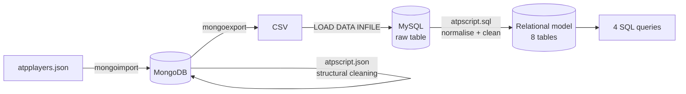
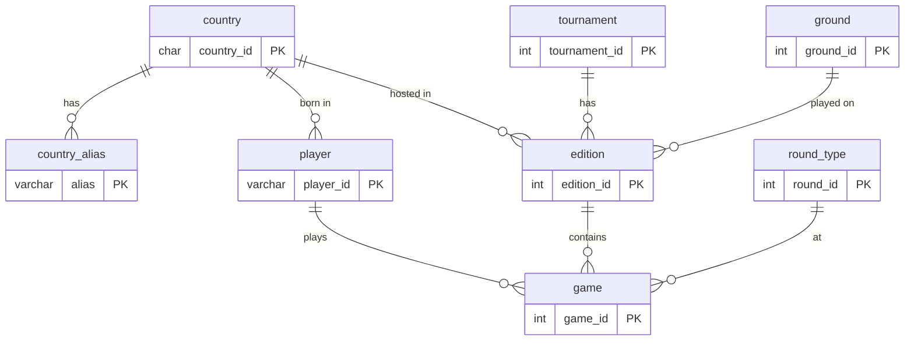

# ATP Tennis Database: from MongoDB to a Relational MySQL Model

Cleaning 1.3 million ATP singles match records in MongoDB, then designing and loading a normalised relational database in MySQL with full integrity constraints, and answering four analytical questions in SQL.

Individual project for the *Big Data Management* (Gestão de Big Data) course, MSc in Data Science, ISCTE (2025/26).

## Data

`atpplayers.json`, provided by the course: 1,308,835 documents scraped from [atptour.com](https://www.atptour.com/en), each one a singles match seen from one player's side (player, birthplace, height, hand, tournament, location, dates, surface, prize money, round, opponent, opponent rank, W/L and score). It covers 9,960 players and 22,235 tournament editions, mostly between 1973 and 2022, including ATP Tour, Grand Slams, Challengers, Futures, Davis Cup and qualifying rounds.

The dataset is not included in this repository (it is course material and about 1 GB once exported).

## Questions

1. For each country: number of players, tournaments and rounds
2. Top 10 players by % of matches won
3. Top 10 left-handed players by % of matches won in Grand Slams
4. Top 5 players by matches won on hard courts

## Pipeline



Cleaning is split between the two databases: MongoDB handles structure and invalid records, MySQL handles normalisation and business rules. `pipeline/correr_pipeline.bat` ran every step end to end on Windows with the course's Docker setup (MongoDB and MySQL containers) and logged the row counts at each stage. It expects that course folder layout, so the commands under [How to run](#how-to-run) are the portable version.

### MongoDB (`mongodb/atpscript.json`)

- Renames misspelled fields (`Oponent` → `Opponent`, `GameRound` → `Round`)
- Builds a `PlayerId` from the ATP profile link, because 7 names are shared by different players
- Trims text and turns empty, `"NA"` and `"-"` values into nulls
- Removes 19,260 byes (not real matches) and 2,746 exact duplicates

### MySQL (`mysql/atpscript.sql`)

- Splits `Hand` ("Right-Handed, Two-Handed Backhand") into hand and backhand
- Parses date ranges into `start_date` and `end_date`, nulls impossible heights (0, 3, 510 cm) and flags 5,484 walkovers
- Maps free-text birthplaces and venues ("Belgrade, Serbia", "Miami, FL", "U.S.A.", "Czechoslovakia") to ISO 3166-1 countries through a table of 1,187 aliases. Cities with no country were matched with the GeoNames database only when the name is unambiguous, and about 100 misspelled or badly encoded names were mapped by hand
- Logs every cleaning count in a `cleaning_log` table

The script has no external file dependencies (the country list is inserted by the script itself) and can be run repeatedly.

## Relational model



| Table | Rows | Key constraints |
|---|---|---|
| `game` | 1,286,812 | FKs to player, edition and round; UNIQUE (player, edition, round, opponent); `result IN ('W','L')` |
| `edition` | 22,235 | FKs to tournament, country and surface; UNIQUE (tournament, venue, dates); `end_date >= start_date` |
| `player` | 9,960 | FK to country; height between 150 and 220 cm; CHECK on hand and backhand values |
| `tournament` | 5,332 | UNIQUE name; Grand Slam flag |
| `country` / `country_alias` | 249 / 1,187 | ISO 3166-1 codes |
| `round_type` / `ground` | 13 / 4 | UNIQUE names; round order and qualifying flag |

Tournament and edition are separate tables ("Wimbledon" vs "Wimbledon 2019"), so surface and prize money are stored once per edition instead of being repeated across 1.3 million rows. Overall, 22,023 rows (1.7%) are dropped between the original file and the final `game` table, almost all of them byes.

## Results

All four queries run in under 2 seconds. Aggregating the matches before joining player names took query 2 from 10 s to 0.7 s.

**Top 10 by % of matches won** (minimum 25 wins, walkovers excluded)

| Player | Wins | Matches | Win % |
|---|---|---|---|
| Rafael Nadal | 1,119 | 1,343 | 83.32 |
| Novak Djokovic | 1,045 | 1,262 | 82.81 |
| Bjorn Borg | 654 | 794 | 82.37 |
| Jimmy Connors | 1,275 | 1,558 | 81.84 |
| Roger Federer | 1,267 | 1,549 | 81.79 |

**Top 5 left-handers in Grand Slams** (main draw only)

| Player | Wins | Matches | Win % |
|---|---|---|---|
| Rafael Nadal | 298 | 339 | 87.91 |
| Jimmy Connors | 233 | 282 | 82.62 |
| John McEnroe | 167 | 205 | 81.46 |
| Guillermo Vilas | 138 | 183 | 75.41 |
| Goran Ivanisevic | 110 | 160 | 68.75 |

**Most wins on hard courts:** Federer (790), Djokovic (648), Agassi (606), Ti Chen (606) and Yen-Hsun Lu (562). The last two appear because the data includes Challenger and Futures matches.

The full output of all four queries is in [`results/atpscript_output.txt`](results/atpscript_output.txt), and [`results/atpSqlResult.pptx`](results/atpSqlResult.pptx) has one results table per question.

**Main limitation:** 63% of players have no birthplace in the source data, so the country is known for only 3,667 of the 9,960 players. Of the players who do have a birthplace, 99.5% were matched to a country.

## Repository structure

```
mongodb/atpscript.json        # mongosh cleaning script
mysql/atpscript.sql           # relational model, SQL cleaning and the 4 queries
pipeline/correr_pipeline.bat  # end-to-end run on Windows with the course's Docker setup
pipeline/import_mysql.sql     # loads the exported CSV into the raw MySQL table
results/atpscript_output.txt  # cleaning counts and query results from a full run
results/atpSqlResult.pptx     # results tables (Portuguese)
```

## How to run

With `atpplayers.json` imported into a MongoDB collection `atpplayers` in database `atp`:

```bash
mongosh "mongodb://localhost:27017/atp" --file mongodb/atpscript.json
mongoexport --uri "mongodb://localhost:27017/atp" --collection atpplayers --type csv \
  --fields PlayerId,PlayerName,Born,Height,Hand,Tournament,Location,Date,Ground,Prize,Round,OpponentRank,Opponent,WL,Score \
  --out atpplayers.csv
# load the CSV into MySQL with pipeline/import_mysql.sql, then:
mysql -u <user> -p < mysql/atpscript.sql
```

`atpscript.sql` takes about 2 minutes and prints the cleaning counts and the four query results. It was tested on MySQL 8.0 and 9.5.

## Tech stack

MongoDB (mongosh, mongoimport, mongoexport) · MySQL (DDL, constraints, indexes, aggregate queries) · Docker · GeoNames
